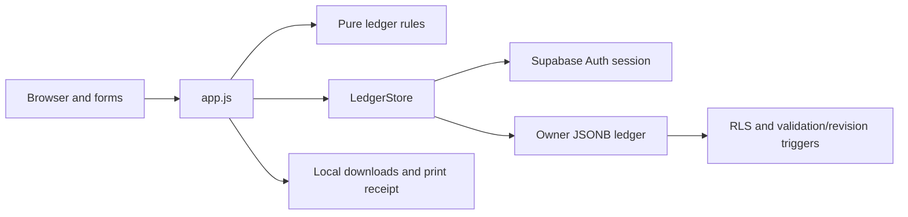

# Understand School Service Payments

This is a small owner-operated school-service ledger. It tracks students, agreed monthly fees, charges, actual receipts, and outstanding balances; it does not process payments or move money. The current source is version 2.0.0 and uses Supabase authentication plus one cloud ledger snapshot per owner.

Read this narrative first, then use the file/symbol catalog and interactive graph to move from broad architecture into individual functions. Financial values below describe schema rules only, never actual customer records.

## Architecture and execution

`index.html` provides the DOM targets. `src/app.js` owns account and page state, renders HTML templates, routes hash navigation, opens forms, and delegates money/state rules to `src/model.js`. `src/cloud.js` wraps the Supabase SDK and its owner-specific ledger table. There is no project-owned REST backend: `server.mjs` is an allowlisted static development server, and the deployed frontend talks directly to Supabase.

`build.mjs` removes/recreates only dist, bundles the app and SDK with esbuild, and copies the shell/CSS. Source files and account records are not exposed by the local server. Hosting headers and local-server CSP restrict browser connections to the configured Supabase origin. Public browser configuration is intentionally public; database row policies are the actual owner-isolation boundary.



## Core records and invariants

| Record | Fields and rules |
|---|---|
| Ledger | version 1, nonnegative safe-integer revision, students/invoices/payments arrays; up to 50,000 in each |
| Student | globally unique id, nonempty bounded name, optional bounded school/route/contact, positive integer-centavo fee, archived boolean |
| Invoice | id, existing studentId, YYYY-MM service period, real due date, positive integer-centavo amount, bounded note; unique student+period |
| Payment | id, existing invoiceId, positive centavo amount, real date, enumerated method, bounded reference, voided flag and required reason when voided |
| Cloud row | owner_id UUID primary key, revision, complete validated data JSONB, unique operation identifier last_mutation, updated_at |

Amounts are integer centavos, up to 100,000,000 per fee/charge/payment (PHP 1,000,000); parsing accepts at most two decimal places. IDs are unique across all three collections. Sum of non-voided payments cannot exceed a charge. Updating a student's fee affects future charges only; every invoice stores its own amount. Archive excludes students from future charge generation but preserves charges/payments. Voiding reverses arithmetic without deleting the payment history.

Status precedence is Paid when remaining balance is zero; otherwise Overdue when due date precedes today's Asia/Manila date; otherwise Partial when any amount is paid; otherwise Unpaid. Service-month dashboard collected totals attach receipts to invoice month. The cash chart uses actual payment date, so it answers a different accounting question. Gross receipts are not profit and receipts are acknowledgments rather than tax invoices.

## End-to-end workflows

1. **Sign in:** browser validates form shape, Supabase signs in or sends confirmation, account-generation state resets, and LedgerStore loads the owner row. No row means an empty revision-zero ledger without a write. SDK persists auth sessions; financial records are not separately cached by this app in localStorage.
2. **Refresh:** a 15-second visible-page poll plus focus/online/manual events request updates. Automatic refresh does not replace a ledger while a modal is open or a save is active. The UI adopts the returned revision only when safe. A load failure leaves the existing ledger intact and displays a warning.
3. **Add/edit/archive student:** validate fields and integer amount, clone the ledger, modify the student, and commit the full snapshot. Historical invoices stay unchanged.
4. **Generate charges:** preview active students lacking a charge for the chosen month, copy their current fee into invoices, skip existing charges, and reject an empty creation. Nothing is sent automatically to students.
5. **Record receipt:** choose an open charge and actual date/method/reference; reject future dates and overpayments; commit, close on confirmed success, and rerender totals. Failed writes retain the edit form.
6. **Correct a record:** charge edits cannot reduce below paid totals; voiding a receipt requires a reason and preserves the original record; unsaved form closure prompts before discard.
7. **Backup/export/restore:** JSON includes the complete versioned ledger; CSV quotes cells and neutralizes formula prefixes; print creates an acknowledgment. Restore validates a smaller-than-10-MB JSON file and explicitly replaces the account snapshot across devices. It does not merge competing copies or change the signed-in owner.

## Concurrency and failure handling

LedgerStore uses expected revision zero for a first insert, otherwise UPDATE with both owner and expected revision predicates. It writes revision+1 and a fresh mutation UUID. A successful response adopts the saved data. If the response fails or returns no matching row, a read checks last_mutation: matching UUID confirms that the write committed despite the lost response. A changed revision reports another-device conflict; unresolved status asks the user to refresh and inspect history before retrying. There is no offline queue or automatic merge.

The database separately validates ledger JSON, owner ID, allowed authenticated non-anonymous user, monotonic revision, changed mutation ID, and timestamp. The source contains a migration, not proof of the live deployed schema. Never run migrations or the SQL test automatically against production; they require a separately approved disposable/controlled database.

Potential growth limits follow directly from the design: every write transfers a complete JSON snapshot; synchronous validation and whole-array scans suit a small roster rather than a high-volume multi-operator accounting system. Restoration can deliberately overwrite newer account data after confirmation. Keep private backups outside this analysis.

## Development and test commands

These are documented/manifest commands, not executed during this analysis:

```powershell
# From this project; dependency installation needs its own authorization when needed.
npm ci
npm run check
npm test
npm run build
npm start
```

Node 22+ is declared. Start builds then listens at 127.0.0.1:5173. Tests build first; model/cloud cases use synthetic objects/mocks, while the server case needs a free 5173 and built output. `tests/cloud-rls.sql` is a separate transaction-based database regression source and is not part of node --test. `tests/MANUAL.md` is the browser/multi-device acceptance checklist. No live authentication, database, browser, or financial-record inspection was done here.

## Coverage, verification and recovery of analysis artifacts

Snapshot: 2026-10-29T08:03:17.235Z; source Git baseline: `58edcbf1f68433b51d5a8e3e3a7a31b288e39470`. The workspace may contain uncommitted/untracked files; the scan digest, not the commit alone, identifies the analyzed content.

- Allowed files covered: **24/24**; 103 nodes, 324 edges, 6 layers, 9 tour steps.
- Category counts: docs 7, code 9, markup 2, config 4, data 2.
- Executed: bundled scan, import resolution, batch computation, structural extraction, batch merge, topology analysis, graph schema/reference/file/symbol/range checks, and fingerprint baseline generation before metadata finalization.
- This session did not run application test suites, launch the real app, inspect excluded runtime stores, contact providers/Supabase, or perform cloud/production changes. Existing verification documents are historical evidence only.
- Machine artifacts: [knowledge graph](.ua/knowledge-graph.json), [coverage report](.ua/coverage-report.json), [symbol inventory](.ua/symbol-inventory.json), [topology](.ua/topology.json), [exclusions](.ua/.understandignore), and [fingerprints](.ua/fingerprints.json).
- To view interactively, ask Codex: `$understand-dashboard C:/Users/222170/Documents/James-Workspace/04-Personal-Projects/school-service-payments`. This uses the installed local dashboard; no application provider connection is needed.
- To refresh after source changes, ask Codex: `$understand C:/Users/222170/Documents/James-Workspace/04-Personal-Projects/school-service-payments`. Use `--full` to rebuild. Automatic commit hooks are disabled.
- Rollback: remove only newly generated `UNDERSTAND.md` and this project's new analysis artifacts after reviewing their paths. Leave source, cloud records, original documents and private runtime stores untouched. No application code was modified.

### Explicit limitations

- Static source analysis only; no app/browser/provider/database acceptance tests were run.
- Excluded credentials, saved knowledge, uploaded documents, runtime stores, dependencies, generated outputs, and binary media.
- Bundled scanner used recursive traversal because git ls-files was unavailable.
- Symbol and call coverage is parser-derived, not whole-program dynamic execution or proof of behavior.
- No structural parser for: index.html. File nodes and semantic/manual source review retained.
- No structural parser for: src/styles.css. File nodes and semantic/manual source review retained.
- SQL parser labeled public.service_ledgers as public; semantic table node corrects the qualified name using the migration source.

A detailed static map is a learning aid, not a line-by-line proof. It does not establish live service configuration, dependency safety, exact runtime reachability, financial correctness for every scenario, or that generated model text is entailed by its citations. Consult the linked source for authoritative behavior.

## File-by-file reading map

Every allowed scanned file has a node. Line totals refer to the scan snapshot, including blank lines. Binary media, generated output, private runtime data and credentials are intentionally outside this inventory.

### Product and operating guidance

Purpose, UX contract, prior evidence, and manual acceptance instructions.

| File | Lines | Role |
|---|---:|---|
| [DESIGN.md](DESIGN.md) | 116 | Persisted ledger visual direction and interaction rationale; design intent is distinct from runtime acceptance evidence. |
| [PRODUCT.md](PRODUCT.md) | 31 | Product goals, scope boundaries, records, payment rules, and exclusions for the personal school-service ledger. |
| [README.md](README.md) | 76 | User/developer guide for hosted and local usage, cloud privacy/concurrency, backup migration, verification, deployment, and recovery. |
| [TASKS.md](TASKS.md) | 21 | Development task history and recorded delivery outcomes; historical status is not a fresh test result. |
| [UX-CONTRACT.md](UX-CONTRACT.md) | 57 | Written UI behavior contract covering navigation, forms, loading/errors, confirmation/recovery, and accessibility expectations. |
| [VERIFICATION.md](VERIFICATION.md) | 34 | Recorded prior verification scope and unresolved manual checks; this analysis does not re-run or independently certify those results. |
| [tests/MANUAL.md](tests/MANUAL.md) | 27 | Human browser acceptance checklist for ledger flows, cloud sign-in, multi-device conflicts, backups, accessibility, and mobile behavior. |

### Browser workflow and presentation

Account/loading/navigation state, ledger forms, tables, receipts, and responsive styling.

| File | Lines | Role |
|---|---:|---|
| [src/app.js](src/app.js) | 405 | Browser application coordinating Supabase account state, cloud refreshes, dashboard/roster/charge/payment views, accessible forms, confirmations, receipts, and backup/export flows. Domain arithmetic lives in model.js and persistence in LedgerStore. |
| [index.html](index.html) | 40 | Static application shell containing navigation, content region, account/sync status, dialog, toast, and printable receipt targets populated by app.js. |
| [src/styles.css](src/styles.css) | 15 | Complete responsive ledger presentation, including navigation, tables, status badges, modal states, reduced-motion behavior, and print receipt styling. |

### Ledger domain rules

Pure integer-money, validation, invoice/payment operations, metrics, and export formatting.

| File | Lines | Role |
|---|---:|---|
| [src/model.js](src/model.js) | 79 | Pure ledger rules using integer centavos, date-only validation, student/invoice/payment integrity checks, immutable charge/payment updates, service-month metrics, and spreadsheet-safe CSV output. |

### Owner ledger persistence

Supabase client configuration, concurrency control, database schema, validation, grants and RLS.

| File | Lines | Role |
|---|---:|---|
| [src/cloud.js](src/cloud.js) | 33 | Creates the Supabase client with persisted PKCE authentication sessions and implements owner-filtered JSON ledger loading and revision-checked writes with mutation-ID reconciliation. |
| [src/config.js](src/config.js) | 3 | Browser-visible Supabase endpoint and publishable-key configuration. These public settings are not a substitute for RLS; no value is reproduced in this graph. |
| [supabase/migrations/20261020163028_cloud_ledger.sql](supabase/migrations/20261020163028_cloud_ledger.sql) | 93 | Defines one JSONB ledger per authenticated owner, payload validation, owner-only non-anonymous RLS policies, limited grants, revision/mutation triggers, and update timestamps. |

### Build and static delivery

Manifest, static build, loopback file server and hosting headers.

| File | Lines | Role |
|---|---:|---|
| [package.json](package.json) | 22 | Pinned Supabase/esbuild dependencies, Node 22 requirement, and start/check/test/build command definitions. |
| [premium-audit.json](premium-audit.json) | 13 | Machine-readable historical UI audit findings and verification status. |
| [premium-ui.json](premium-ui.json) | 11 | Machine-readable UI context and product design settings. |
| [vercel.json](vercel.json) | 15 | Static deployment build/output settings and browser security headers, including a fixed Supabase connection destination. |
| [build.mjs](build.mjs) | 8 | Recreates dist, bundles app.js and Supabase dependencies into a minified ES module, and copies the HTML/CSS for static hosting. |
| [server.mjs](server.mjs) | 17 | Loopback development server allowing only the built HTML, JavaScript, and stylesheet through GET/HEAD; sends security and no-store headers and rejects other paths/methods. |

### Synthetic regression sources

Node-based model/cloud/server tests and transactional database test script.

| File | Lines | Role |
|---|---:|---|
| [tests/cloud.test.js](tests/cloud.test.js) | 55 | Fluent-client mocks verify owner-scoped loads, first inserts, expected-revision updates, stale-device rejection, uncertain responses, and invalid-save prevention without contacting Supabase. |
| [tests/model.test.js](tests/model.test.js) | 77 | Synthetic unit cases for exact money/date handling, duplicate-safe charges, partial/full/void payments, metrics, backup validation, and CSV formula neutralization. |
| [tests/cloud-rls.sql](tests/cloud-rls.sql) | 57 | Transactional database regression script for owner isolation, anonymous denial, stale updates, and invalid payloads. It is source evidence only; not executed by this analysis. |
| [tests/server.test.js](tests/server.test.js) | 22 | Starts a synthetic loopback child server to check static allowlisting, security headers, unsupported paths, and write rejection; requires built files and a free port. |

## Function, method, class and endpoint catalog

All declarations returned by the bundled parser are retained, including short helpers; selected parser gaps were supplemented explicitly. Arrow callbacks, framework-created accessors, and dynamic dispatch are not separately exhaustive. IDs for overloads include their declaration line. The JSON graph and symbol inventory preserve machine-readable detail.

### src/app.js

| Symbol | Kind | Source lines | Behavior |
|---|---|---|---|
| $ | function | 3–3 | Implements $ within app.js. See its source range and caller/dependency links for the exact behavior. |
| esc | function | 4–4 | Implements esc within app.js. See its source range and caller/dependency links for the exact behavior. |
| uid | function | 5–5 | Implements uid within app.js. See its source range and caller/dependency links for the exact behavior. |
| dateLabel | function | 6–6 | Implements date label within app.js. See its source range and caller/dependency links for the exact behavior. |
| monthLabel | function | 7–7 | Implements month label within app.js. See its source range and caller/dependency links for the exact behavior. |
| initials | function | 8–8 | Implements initials within app.js. See its source range and caller/dependency links for the exact behavior. |
| warning | function | 22–22 | Implements warning within app.js. See its source range and caller/dependency links for the exact behavior. Parameters: message. |
| notify | function | 23–27 | Implements notify within app.js. See its source range and caller/dependency links for the exact behavior. Parameters: message. |
| commit | function | 34–48 | Serializes cloud writes, requires a loaded online ledger, detects account-generation changes, and adopts state only after a confirmed save. Parameters: next. |
| syncLabel | function | 49–49 | Implements sync label within app.js. See its source range and caller/dependency links for the exact behavior. Parameters: message. |
| refreshLedger | function | 50–69 | Loads the owner ledger without overwriting an open modal, adopts revision only when safe, updates status, and preserves state on failure. |
| authScreen | function | 70–89 | Renders sign-in/signup UI, validates credentials locally, and delegates account operations to Supabase Auth. |
| setAccount | function | 90–104 | Resets account-scoped state and dialogs, creates an owner-bound store, and refreshes the selected account ledger. Parameters: user. |
| student | function | 109–109 | Implements student within app.js. See its source range and caller/dependency links for the exact behavior. |
| invoice | function | 110–110 | Implements invoice within app.js. See its source range and caller/dependency links for the exact behavior. |
| badge | function | 111–111 | Implements badge within app.js. See its source range and caller/dependency links for the exact behavior. |
| button | function | 112–112 | Implements button within app.js. See its source range and caller/dependency links for the exact behavior. Parameters: label, action. |
| studentCell | function | 113–113 | Implements student cell within app.js. See its source range and caller/dependency links for the exact behavior. |
| empty | function | 114–114 | Implements empty within app.js. See its source range and caller/dependency links for the exact behavior. Parameters: title, description. |
| heading | function | 115–115 | Implements heading within app.js. See its source range and caller/dependency links for the exact behavior. Parameters: title, subtitle. |
| periodBar | function | 116–116 | Implements period bar within app.js. See its source range and caller/dependency links for the exact behavior. |
| kpi | function | 117–117 | Implements kpi within app.js. See its source range and caller/dependency links for the exact behavior. Parameters: label, value, foot, icon. |
| pagination | function | 118–121 | Implements pagination within app.js. See its source range and caller/dependency links for the exact behavior. Parameters: total. |
| searchBar | function | 122–124 | Implements search bar within app.js. See its source range and caller/dependency links for the exact behavior. Parameters: options, placeholder. |
| paginate | function | 125–125 | Implements paginate within app.js. See its source range and caller/dependency links for the exact behavior. Parameters: list. |
| trend | function | 126–135 | Builds six months of cash-received activity using payment dates rather than service months. |
| dashboard | function | 136–149 | Renders service-month accounting totals, cash activity, outstanding balances, and navigation actions. |
| chargeRow | function | 150–153 | Implements charge row within app.js. See its source range and caller/dependency links for the exact behavior. Parameters: i. |
| chargesView | function | 154–159 | Implements charges view within app.js. See its source range and caller/dependency links for the exact behavior. |
| studentsView | function | 160–164 | Implements students view within app.js. See its source range and caller/dependency links for the exact behavior. |
| paymentsView | function | 165–172 | Implements payments view within app.js. See its source range and caller/dependency links for the exact behavior. |
| backupView | function | 173–175 | Implements backup view within app.js. See its source range and caller/dependency links for the exact behavior. |
| render | function | 176–185 | Selects the current account/loading/page state, renders the matching view, and updates display metrics. |
| navigate | function | 186–191 | Resolves known hash routes and resets pagination/search/filter state for the next view. |
| field | function | 194–194 | Implements field within app.js. See its source range and caller/dependency links for the exact behavior. Parameters: name, label. |
| form | function | 195–195 | URL-encodes request form values for the authentication transport. Parameters: content. |
| modal | function | 196–225 | Opens an accessible dialog, captures the original form draft, serializes submission, checks fields, and keeps failed edits available. Parameters: title, html, handler. |
| close | function | 226–235 | Closes a non-saving dialog, clears its draft, and restores focus to its opener or the main region. |
| dirty | function | 236–239 | Compares current form entries against the captured draft to detect unsaved changes. |
| requestClose | function | 240–250 | Blocks closing while saving and presents an explicit discard choice when the form is dirty. |
| required | function | 254–261 | Requires a present bounded string field or returns a generic validation failure. Parameters: data, key, label. |
| amountValue | function | 262–265 | Implements amount value within app.js. See its source range and caller/dependency links for the exact behavior. Parameters: data, key. |
| studentForm | function | 266–275 | Creates or edits a student and agreed monthly fee while preserving historical charges. Parameters: id. |
| chargesForm | function | 276–292 | Previews duplicate-safe monthly charge creation for active students, then commits the selected month. |
| paymentForm | function | 293–302 | Selects an unpaid charge, collects actual receipt details, applies model validation, and commits a partial or full payment. Parameters: id. |
| editCharge | function | 303–313 | Updates charge amount/due/note while preventing reductions below payments already received. Parameters: id. |
| archiveStudent | function | 314–322 | Confirms archive/restore and toggles future-charge eligibility while retaining financial history. Parameters: id. |
| voidPayment | function | 323–332 | Requires a correction reason, marks the payment voided, and retains the original record in history. Parameters: id. |
| receipt | function | 333–338 | Builds an escaped printable payment acknowledgment with dates, method, reference, and void status. Parameters: id. |
| download | function | 339–343 | Creates a temporary Blob URL for a browser download and revokes it after use. Parameters: name, data, type. |
| exportCharges | function | 344–348 | Exports selected-month charges with student details, amounts, balances, and derived status. |
| exportPayments | function | 349–353 | Exports the full payment history, including voided entries and correction reasons. |

### src/cloud.js

| Symbol | Kind | Source lines | Behavior |
|---|---|---|---|
| LedgerStore | class | 7–33 | Creates the Supabase client with persisted PKCE authentication sessions and implements owner-filtered JSON ledger loading and revision-checked writes with mutation-ID reconciliation. |
| LedgerStore.constructor | function | 8–8 | Stores the Supabase client and owner ID with initial expected revision zero. |
| LedgerStore.load | function | 9–14 | Reads only the selected owner row and validates its ledger; intentionally leaves expected revision adoption to the UI. |
| LedgerStore.save | function | 15–32 | Increments the expected revision, validates the snapshot, inserts/compares revision atomically, and reconciles uncertain completion by a unique mutation ID. |

### src/model.js

| Symbol | Kind | Source lines | Behavior |
|---|---|---|---|
| emptyState | function | 2–2 | Creates the version-1, revision-zero ledger with empty student, invoice, and payment arrays. |
| today | function | 3–3 | Formats the current calendar date in Asia/Manila; ledger due-date decisions use this timezone. |
| validDate | function | 4–6 | Checks ISO date shape, allowed year range, parsing, and exact calendar round-trip. Parameters: value. |
| cents | function | 7–13 | Parses a positive decimal PHP amount into safe integer centavos and rejects exponent notation, excess precision, zero, and excessive amounts. Parameters: value. |
| money | function | 14–14 | Formats integer centavos as PHP currency for display. |
| paid | function | 15–15 | Sums non-voided payments linked to an invoice. Parameters: state, invoiceId. |
| balance | function | 16–16 | Subtracts active payments from the charge amount. Parameters: state, invoice. |
| status | function | 17–22 | Returns non-secret current status for model.js, without exposing account credentials or source text. Parameters: state, invoice. |
| fail | function | 23–23 | Implements fail within model.js. See its source range and caller/dependency links for the exact behavior. |
| text | function | 24–24 | Implements text within model.js. See its source range and caller/dependency links for the exact behavior. Parameters: value, max. |
| amount | function | 25–25 | Implements amount within model.js. See its source range and caller/dependency links for the exact behavior. |
| validateState | function | 26–49 | Checks ledger version/revision, collection limits, global ID uniqueness, valid records/references, unique student-month charges, and absence of overpayments. Parameters: state. |
| addPayment | function | 50–58 | Rejects unknown invoices, future/invalid dates, and overpayments; clones the ledger, adds a non-voided payment, and validates the result. Parameters: state, payment. |
| createCharges | function | 59–66 | Clones the ledger and adds one fee-snapshot charge for each active student missing the selected month, then validates the result. Parameters: state. |
| metrics | function | 67–72 | Computes billed, collected, outstanding, overdue, paid-count, and total metrics for invoice service month. Parameters: state, period. |
| csv | function | 73–79 | Builds BOM-prefixed quoted CSV with escaped quotes and a protective apostrophe before spreadsheet formula prefixes. Parameters: rows. |

### supabase/migrations/20261020163028_cloud_ledger.sql

| Symbol | Kind | Source lines | Behavior |
|---|---|---|---|
| public.valid_service_ledger | function | 2–56 | Validates JSONB ledger structure, bounded amounts/arrays/fields, unique IDs/student-month charges, references, dates and absence of overpayment; invalid input returns false. |
| public.service_ledgers | table | 59–66 | One row per auth owner: owner_id UUID primary key, revision bigint, validated ledger data JSONB, last_mutation UUID, updated_at timestamp. RLS and grants permit authenticated non-anonymous owners to select/insert/update only their row. |
| public.guard_service_ledger_revision | function | 77–90 | Enforces insert revision one, immutable owner, revision increment, changed mutation ID, and update timestamp. |

### tests/cloud.test.js

| Symbol | Kind | Source lines | Behavior |
|---|---|---|---|
| client | function | 5–9 | Synthetic test/helper for client. Read the test body for exact fixture and assertions; its existence is not evidence it passed in this analysis. Parameters: responses. |
| row | function | 10–10 | Synthetic test/helper for row. Read the test body for exact fixture and assertions; its existence is not evidence it passed in this analysis. Parameters: revision. |

### tests/model.test.js

| Symbol | Kind | Source lines | Behavior |
|---|---|---|---|
| fixture | function | 4–9 | Synthetic test/helper for fixture. Read the test body for exact fixture and assertions; its existence is not evidence it passed in this analysis. |
| payment | function | 10–10 | Synthetic test/helper for payment. Read the test body for exact fixture and assertions; its existence is not evidence it passed in this analysis. |

## Direct dependency map

Only resolved local imports and source-backed collaborator dependencies are listed below. External libraries are described in the manifest and architecture sections. An absent edge is not evidence that two components never interact.

| Consumer | Relationship | Dependency |
|---|---|---|
| [src/app.js](src/app.js) | imports | [src/cloud.js](src/cloud.js) |
| [src/app.js](src/app.js) | imports | [src/model.js](src/model.js) |
| [src/cloud.js](src/cloud.js) | imports | [src/config.js](src/config.js) |
| [src/cloud.js](src/cloud.js) | imports | [src/model.js](src/model.js) |
| [src/cloud.js](src/cloud.js) | depends_on | [supabase/migrations/20261020163028_cloud_ledger.sql](supabase/migrations/20261020163028_cloud_ledger.sql) |
| [src/cloud.js](src/cloud.js) | tested_by | [tests/cloud.test.js](tests/cloud.test.js) |
| [tests/cloud.test.js](tests/cloud.test.js) | imports | [src/cloud.js](src/cloud.js) |
| [tests/cloud.test.js](tests/cloud.test.js) | imports | [src/model.js](src/model.js) |
| [tests/model.test.js](tests/model.test.js) | imports | [src/model.js](src/model.js) |
| [src/model.js](src/model.js) | tested_by | [tests/model.test.js](tests/model.test.js) |
| [package.json](package.json) | configures | [build.mjs](build.mjs) |
| [package.json](package.json) | configures | [server.mjs](server.mjs) |
| [package.json](package.json) | configures | [src/app.js](src/app.js) |
| [index.html](index.html) | depends_on | [src/app.js](src/app.js) |
| [index.html](index.html) | depends_on | [src/styles.css](src/styles.css) |
| [vercel.json](vercel.json) | configures | [build.mjs](build.mjs) |
| [server.mjs](server.mjs) | tested_by | [tests/server.test.js](tests/server.test.js) |
| [build.mjs](build.mjs) | depends_on | [src/app.js](src/app.js) |

## Guided learning order

1. **Purpose and operating scope** — Read the user guide and product boundaries first. This application records received school-service payments and monthly charges; it does not move money or calculate profit. Read [README.md](README.md), [PRODUCT.md](PRODUCT.md).
2. **Boot and screen state** — Follow the static shell into the browser entry. Account changes reset local in-memory ledger state before the owner-scoped refresh. Read [index.html](index.html), [src/app.js](src/app.js).
3. **Money and record invariants** — Read the pure domain model before editing forms. Integer centavos, globally unique IDs, reference integrity, and one charge per student/month underpin all totals. Read [src/model.js](src/model.js).
4. **Safe writes across devices** — Study LedgerStore and the UI refresh/commit gates together. Expected revisions reject stale saves, while unique mutation IDs help reconcile lost responses. Read [src/cloud.js](src/cloud.js), [src/app.js](src/app.js).
5. **Owner database boundary** — Inspect the migration source without executing it. Owner RLS, non-anonymous checks, JSONB validation, and revision triggers complement browser checks. Read [supabase/migrations/20261020163028_cloud_ledger.sql](supabase/migrations/20261020163028_cloud_ledger.sql).
6. **Forms and corrections** — Return to app.js for student, charge, partial payment, archive, and void flows. Historical records are retained; confirmations and failed-draft retention matter. Read [src/app.js](src/app.js), [UX-CONTRACT.md](UX-CONTRACT.md).
7. **Exports and recovery** — Inspect CSV/JSON backup generation and explicit ledger replacement. A JSON restore overwrites the account snapshot; it is not a merge between devices. Read [src/model.js](src/model.js), [src/app.js](src/app.js), [README.md](README.md).
8. **Static delivery** — Read the bundler, allowlisted loopback server, and hosting headers. The local server exposes built frontend files, not a custom ledger API. Read [build.mjs](build.mjs), [server.mjs](server.mjs), [vercel.json](vercel.json).
9. **Tests and remaining evidence** — Compare model/cloud mock tests with server and database checks. Test source coverage is not a live Supabase or current browser verification result. Read [tests/model.test.js](tests/model.test.js), [tests/cloud.test.js](tests/cloud.test.js), [tests/server.test.js](tests/server.test.js), [tests/cloud-rls.sql](tests/cloud-rls.sql), [VERIFICATION.md](VERIFICATION.md).
